

<picture><source media="(prefers-color-scheme: dark)" srcset="assets/hero-dark.svg"></picture>

<picture><source media="(prefers-color-scheme: dark)" srcset="assets/social-l-dark.svg"></picture><a href="https://www.tiktok.com/@tudustech"><picture><source media="(prefers-color-scheme: dark)" srcset="assets/social-1-dark.svg"></picture></a><a href="Tudustech-Hub"><picture><source media="(prefers-color-scheme: dark)" srcset="assets/social-2-dark.svg"></picture></a><picture><source media="(prefers-color-scheme: dark)" srcset="assets/social-r-dark.svg"></picture>

<picture><source media="(prefers-color-scheme: dark)" srcset="assets/stats-dark.svg"></picture>

<picture><source media="(prefers-color-scheme: dark)" srcset="assets/about-dark.svg"></picture>

<picture><source media="(prefers-color-scheme: dark)" srcset="assets/stack-dark.svg"></picture>

<a href="https://github.com/Tudustech-hub/TuBo"><picture><source media="(prefers-color-scheme: dark)" srcset="assets/project-tubo-dark.svg"></picture></a>&nbsp;<a href="https://github.com/Tudustech-hub/Keyo"><picture><source media="(prefers-color-scheme: dark)" srcset="assets/project-keyo-dark.svg"></picture></a>

<a href="https://github.com/Tudustech-hub/PiVot"><picture><source media="(prefers-color-scheme: dark)" srcset="assets/project-pivot-dark.svg"></picture></a>&nbsp;<a href="https://github.com/Tudustech-hub/TuOS"><picture><source media="(prefers-color-scheme: dark)" srcset="assets/project-tuos-dark.svg"></picture></a>

<picture><source media="(prefers-color-scheme: dark)" srcset="assets/streak-dark.svg"></picture>

<picture><source media="(prefers-color-scheme: dark)" srcset="assets/wave-dark.svg"></picture>

<a href="https://metawka.github.io/expressive-profile/?from=Tudustech-hub"><picture><source media="(prefers-color-scheme: dark)" srcset="assets/credit-dark.svg"></picture></a>

